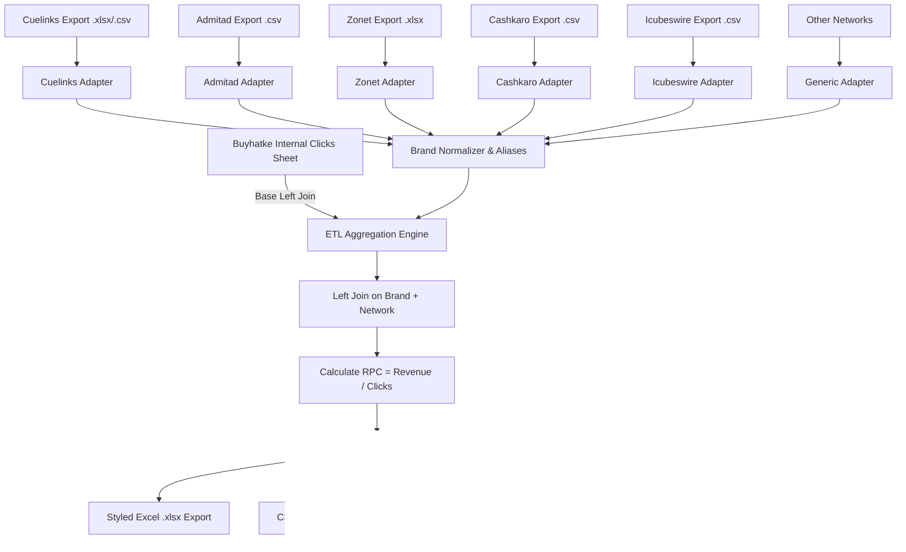

# Affiliate ETL & RPC Automator (Buyhatke Operations)

An automated monthly ETL web application built with **Python**, **FastAPI**, and **Pandas** to replace manual affiliate revenue aggregation, brand reconciliation, and Revenue Per Click (RPC) calculations across multiple networks.

---

## 🎯 Architecture & Workflow



---

## 🚀 Key Features

1. **Multi-File Drag-and-Drop Ingestion:**
   - Drop the internal clicks master file once.
   - Drop all monthly network exports simultaneously (Cuelinks, Admitad, Cashkaro, Zonet, Icubeswire, etc.).
2. **Modular Pandas Network Adapters:**
   - Each network adapter isolates the approved/confirmed revenue columns, handles formatting anomalies (e.g., `₹`, `$`, negative values, blank strings), and normalizes brand names.
3. **Smart Brand Normalizer & Alias Engine:**
   - Cleans messy network strings (e.g., `"Flipkart CPS [IN]"` $\rightarrow$ `"Flipkart"`, `"Amazon US Associates"` $\rightarrow$ `"Amazon US"`).
   - Dynamic alias management in UI: Add new merchant aliases on the fly without changing code.
4. **Left Join & RPC Calculation:**
   - Preserves all Buyhatke internal campaigns.
   - Joins on `[WEBSITE / BRAND, AFFILIATE NETWORK]`.
   - Computes $\text{RPC} = \frac{\text{Revenue}}{\text{Internal Clicks}}$.
5. **Direct Google Sheets Compatibility:**
   - **"Copy for Google Sheets"** button copies cleanly formatted TSV directly to your clipboard. Select cell `A1` in Google Sheets and press `Cmd+V` / `Ctrl+V`!
   - Export to formatted `.xlsx` with custom currency and number formatting.
6. **Orphaned Revenue Auditing:**
   - Automatically alerts if an affiliate network reported revenue for a brand/network pair not present in your internal tracking sheet.

---

## ⚡ Quick Start

### 1. Start the Server
```bash
cd /Users/faizan/.gemini/antigravity/scratch/affiliate-etl-platform
./run.sh
```
Or directly with Python:
```bash
python3 -m uvicorn backend.app:app --host 127.0.0.1 --port 8000 --reload
```

### 2. Open the Web Application
Open your browser and navigate to:
```
http://127.0.0.1:8000
```

### 3. Test with Demo Data
Click the **"Load Demo Data (Sheet Match)"** button on the top right to instantly load the exact brand and network numbers matching your monthly master spreadsheet!

---

## 📂 Project Structure

```
affiliate-etl-platform/
├── backend/
│   ├── app.py                     # FastAPI application endpoints
│   ├── models.py                  # Pydantic data schemas
│   ├── etl/
│   │   ├── base.py                # BaseNetworkAdapter & currency cleaner
│   │   ├── normalizer.py          # Brand/Network normalizer & aliases
│   │   ├── engine.py              # Aggregator & Left Join calculation
│   │   └── adapters/
│   │       ├── cuelinks.py        # Cuelinks adapter
│   │       ├── admitad.py         # Admitad adapter
│   │       ├── cashkaro.py        # Cashkaro adapter
│   │       ├── zonet.py           # Zonet adapter
│   │       ├── icubeswire.py      # Icubeswire adapter
│   │       └── generic.py         # Dynamic fallback adapter
│   └── sample_data/               # Pre-packaged sample datasets
├── frontend/
│   └── static/
│       ├── index.html             # Modern Tailwind dashboard
│       ├── app.js                 # Drag-drop, table rendering & copy logic
│       └── style.css              # Custom styling
├── tests/
│   └── test_etl.py                # Pipeline unit tests
├── requirements.txt
├── run.sh
└── README.md
```
